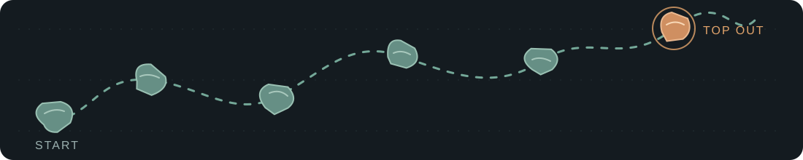

<div align="center">

# JiaJin Zhou

### *Solving problems, one hold at a time.*

**Data & AI Engineering · Automation · Analytics**



[](https://github.com/JiajinZ)
[](https://www.linkedin.com/in/jiajin-zhou-81a220161/)

</div>

### `➜ ~ whoami`

**JiaJin Zhou** — Data & AI Engineering

I build automation, analytics systems, and intelligent tools that turn complex data into practical decisions. I like figuring out why things break, making data reliable, and building tools people can actually use.

### `➜ ~ cat focus.txt`

```text
Data engineering     → Reliable pipelines & validation
Analytics            → Clear insights & decision support
Applied AI           → Useful, grounded workflows
Automation           → Less repetitive work, better systems
```

### `➜ ~ ls toolkit/`

`Python` · `SQL` · `Pandas` · `Plotly` · `Streamlit` · `Power BI` · `Git` · `pytest` · `APIs`

### `➜ ~ cat education.txt`

**M.S. Data Analytics Engineering** — Northeastern University  
**B.F.A., cum laude**

### `➜ ~ cat beyond_code.txt`

Rock climbing. Curiosity. A love for solving hard problems.

> **Build it. Test it. Improve it. Repeat.**
