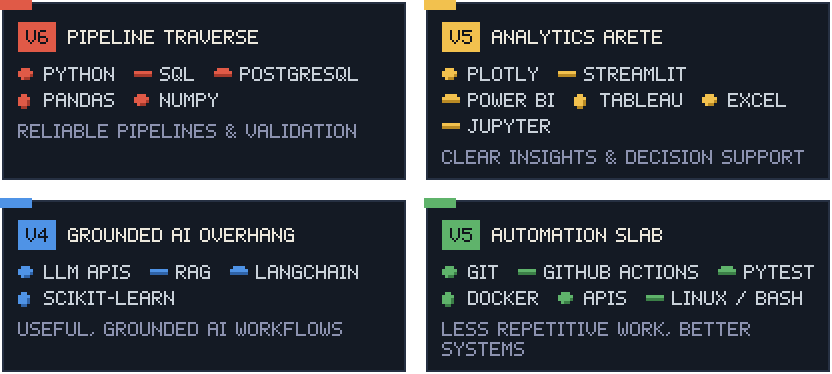
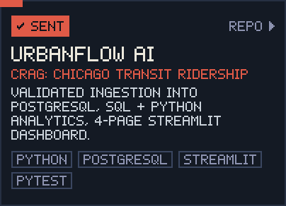
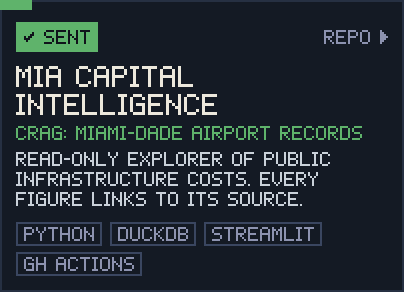
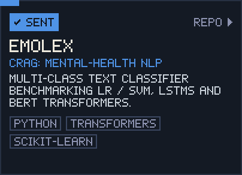
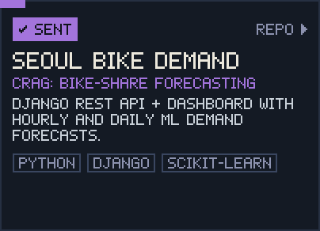
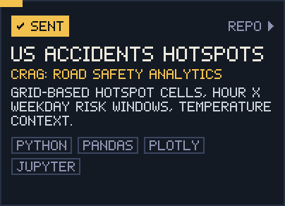
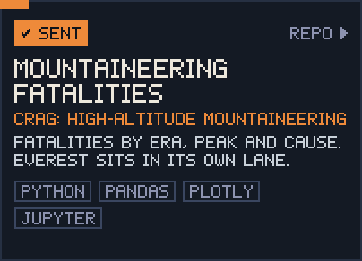

### *Solving problems, one hold at a time.*

### `➜ ~ whoami`

**JiaJin Zhou**, Data & AI Engineering

I build automation, analytics systems, and intelligent tools that turn complex data into practical decisions. I like figuring out why things break, making data reliable, and building tools people can actually use.

### `➜ ~ select --problem`

<!-- skills:start -->

Tape colour = focus area · V-grade = depth · each hold = one skill

Plain-text skill list

- **Pipeline Traverse** (V6): Python, SQL, PostgreSQL, Pandas, NumPy
- **Analytics Arete** (V5): Plotly, Streamlit, Power BI, Tableau, Excel, Jupyter
- **Grounded AI Overhang** (V4): LLM APIs, RAG, LangChain, scikit-learn
- **Automation Slab** (V5): Git, GitHub Actions, pytest, Docker, APIs, Linux / Bash

<!-- skills:end -->

### `➜ ~ cat send_log.txt`

<!-- sends:start -->

Every send links to its repo.
<!-- sends:end -->

### `➜ ~ cat education.txt`

**M.S. Data Analytics Engineering**, Northeastern University

### `➜ ~ cat beyond_code.txt`

Rock climbing. Curiosity. A love for solving hard problems.

> **Build it. Test it. Improve it. Repeat.**
